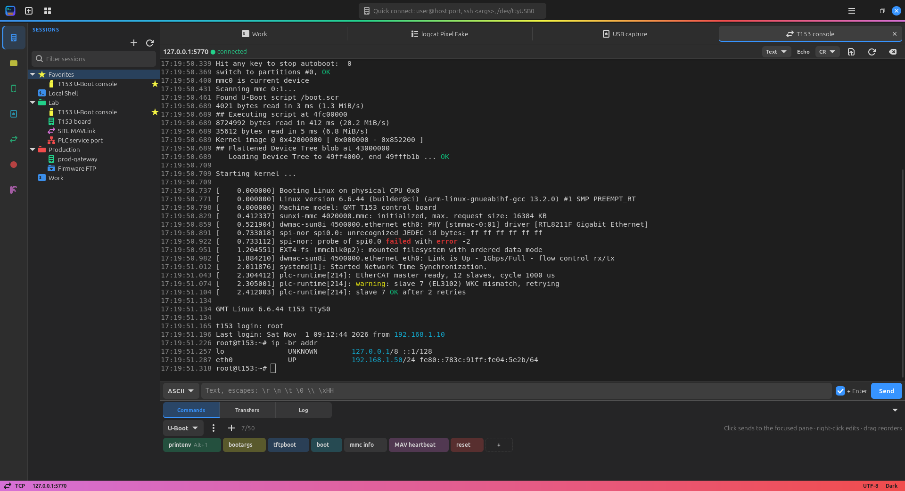
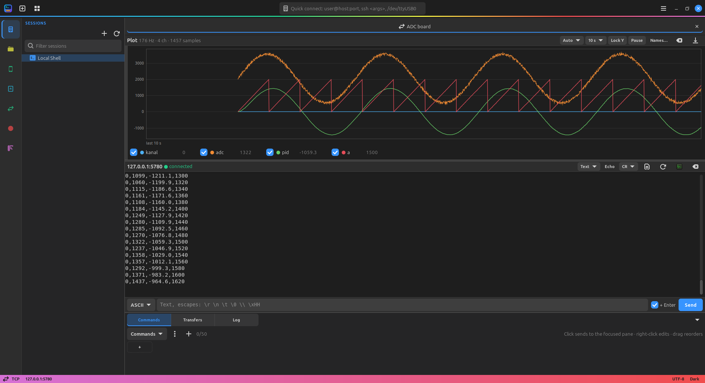
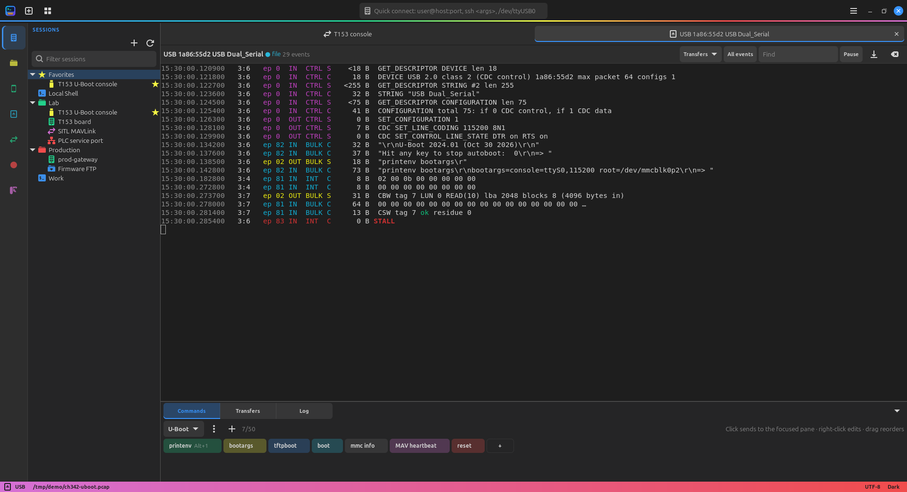
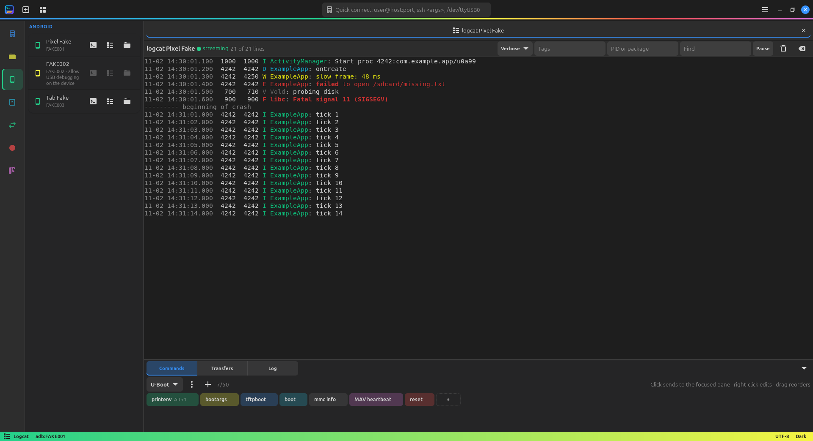
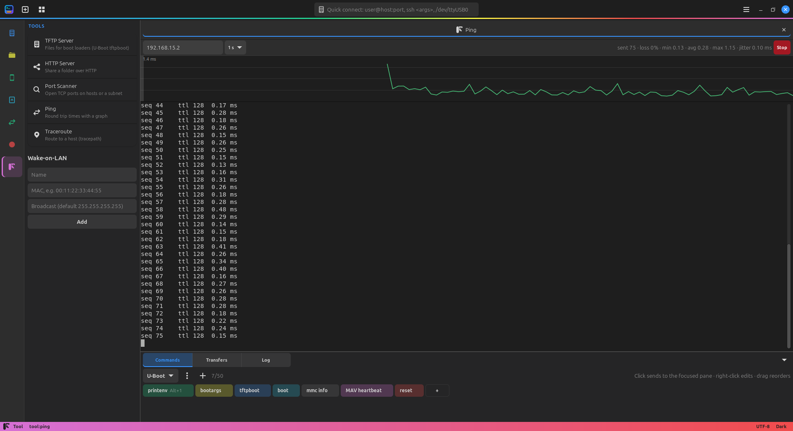
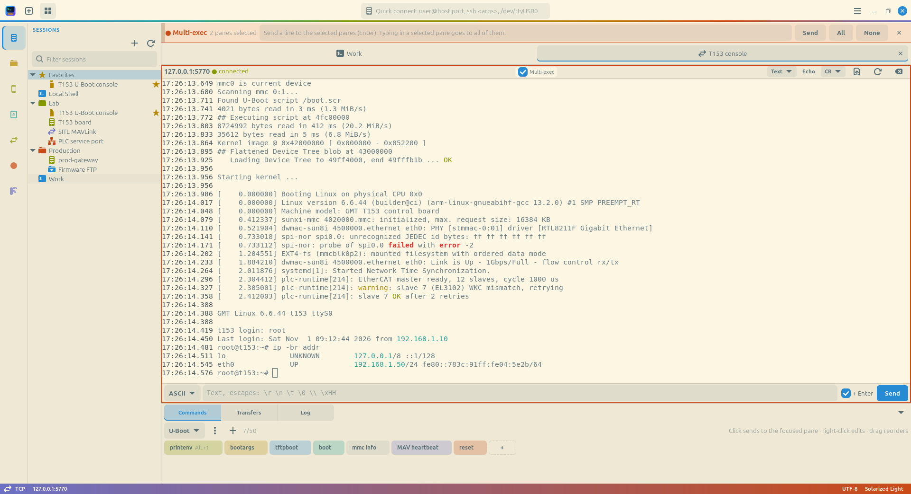

# termvisor

One window for the terminals of embedded and network work on Linux:
serial ports, SSH, telnet, raw TCP, FTP, Android and USB, in tabs and
split panes. Open source (GPL-3.0-or-later), written in Rust with GTK 4.



## Highlights

**Serial and SSH consoles.** A board console with errors, warnings, `OK`
and IP addresses highlighted and a timestamp on every line. The command
buttons below send `printenv`, a multi-line `setenv … / saveenv` with a
delay between lines, or a raw MAVLink frame in hex. Serial ports are
locked against other programs, can be mirrored read-only, and transfer
files with XMODEM, YMODEM and ZMODEM.

**Live plot.** Ctrl+Shift+G draws the numbers a pane prints as a graph
above it: each line is a sample, its fields split by `,` `|` `;` or any
separator but space are the channels. Rate, names from a header line,
per-channel show/hide, hover readout, pause and CSV export.



**USB capture.** Listens to USB traffic without touching it (kernel
usbmon) and decodes it: descriptors, CDC line coding (`115200 8N1`), the
data of USB serial adapters as text, HID keys, mass storage commands,
stalls. A serial view shows a USB UART conversation as plain text; pcap
files open in Wireshark.



**Android.** Devices appear as they are plugged in; one click opens
`adb shell`, a logcat view colored by level with tag, process and text
filters, or the device's files.



**Network tools.** TFTP server for `tftpboot`, HTTP file server, port
scanner, ping with a round trip graph, traceroute, Wake-on-LAN; plus SSH
tunnels (`-L`, `-R`, SOCKS) that reconnect by themselves.



**Multi-exec and themes.** Type once into several panes (red frames mark
them); nine bundled themes, a theme editor with live preview, and themes
per session so a production shell never looks like a test one.



## Features

Connections
- Local shell, SSH (connection sharing, keyring, host key checks), mosh,
  serial, raw TCP, telnet, FTP/FTPS, Android (adb)
- Tabs with nested split panes; quick connect (`user@host:port`,
  `/dev/ttyUSB0@115200`, `telnet://host`, `tcp://host:port`,
  `ftp://host`, `adb://serial`); session tree with folders and favorites
- Serial: locking, read-only mirrors, auto-reconnect on replug, DTR/RTS,
  break; Text, Hex and MAVLink views; ASCII and hex send bar
- Release All: frees ports and connections left by a crash

Files
- SFTP and FTP file panel, transfer queue with resume, edit remote files
  in a local editor, follow the shell's directory
- XMODEM, YMODEM, ZMODEM on serial, TCP and telnet, with ZMODEM auto-start

Automation
- Command panel: pages of up to 50 colored buttons, text or hex, with
  shortcuts and pages per session
- Macros with send, wait and expect steps, recorded or written
- Multi-exec to several panes

Debugging
- Live multichannel plot of separated values in any pane
- Timestamps, regex highlight rules and logging to file in every pane
- Passive USB capture with decoders and pcap export
- Logcat view with level, tag, process and text filters

Tools
- SSH tunnels, TFTP and HTTP servers, port scanner, ping graph,
  traceroute, Wake-on-LAN

Look and feel
- Nine themes, theme editor, per-session themes, follow the system style
- Preferences window, remappable shortcuts, command palette
  (Ctrl+Shift+P)

Specification and milestones: [docs/SPEC.md](docs/SPEC.md).

## Install

- Ubuntu 24.04+ (amd64), from the APT repository:

  ```sh
  curl -fsSL https://ykurt52.github.io/termvisor/key.gpg | sudo gpg --dearmor -o /usr/share/keyrings/termvisor.gpg
  echo "deb [signed-by=/usr/share/keyrings/termvisor.gpg] https://ykurt52.github.io/termvisor stable main" | sudo tee /etc/apt/sources.list.d/termvisor.list
  sudo apt update && sudo apt install termvisor
  ```

- Or the `.deb` from the releases page: `sudo apt install ./termvisor_*.deb`.
- Arch: the `termvisor` AUR package.
- Windows 10/11 (x64), from the releases page: run
  `termvisor-windows-x64_v*_setup.exe` to install, or
  `termvisor-windows-x64_v*_portable.exe` to run without installing.
  USB capture and mosh are Linux only.

Packaging details: [docs/packaging.md](docs/packaging.md).

## Build

Dependencies (Debian/Ubuntu):

```sh
sudo apt install libgtk-4-dev libadwaita-1-dev libsecret-1-dev libudev-dev build-essential pkg-config
```

Dependencies (Arch):

```sh
sudo pacman -S gtk4 libadwaita libsecret base-devel
```

Optional on both: `mosh` for mosh sessions.

Rust 1.92 or newer (via rustup), then:

```sh
cargo build --release
./target/release/termvisor
```

## Performance

`cargo run` builds a debug binary; use `cargo run --release` (or the
packaged build) for daily use.

Inside a VM without 3D acceleration OpenGL is software (llvmpipe) and GTK's
default renderer is slow. With `"renderer": "auto"` (default in
`settings.json`) termvisor detects this and uses the cairo renderer instead.
Measured on a VMware VM while the terminal scrolls:

| Setup | fps |
|---|---|
| GTK default renderer (ngl), debug build | 13 |
| `auto` → cairo, debug build | 50 |
| `auto` → cairo, release build | 58 |

Force a renderer with `"renderer": "cairo" | "gl" | "ngl" | "vulkan"`, or
the `GSK_RENDERER` environment variable (always wins). Enabling 3D
acceleration in the VM settings gives hardware OpenGL; `auto` then keeps
GTK's GPU renderer.

## Shortcuts

| Action | Keys |
|---|---|
| New tab | Ctrl+Shift+T |
| Close pane | Ctrl+Shift+W |
| Split right | Ctrl+Shift+E |
| Split down | Ctrl+Shift+O |
| Copy / Paste | Ctrl+Shift+C / Ctrl+Shift+V |
| Zoom in / out / reset | Ctrl++ / Ctrl+- / Ctrl+0, Ctrl + wheel |
| Quick connect | Ctrl+Shift+L |
| Find session | Ctrl+Shift+K |
| Release all connections | Ctrl+Shift+R |
| Toggle sidebar | Ctrl+Shift+B |
| Toggle bottom panel | Ctrl+Shift+J |
| Multi-exec | Ctrl+Shift+M |
| Command palette | Ctrl+Shift+P |
| Plot values | Ctrl+Shift+G |
| Preferences | Ctrl+, |
| Next / previous tab | Ctrl+PgDn / Ctrl+PgUp |
| Go to tab N | Alt+1..9 |

Drag a tab out of the tab bar to open it in a new window.

An SSH pane stays open when the session ends; press Enter to reconnect.
SSH prompts, connection sharing and the keyring: [docs/ssh.md](docs/ssh.md).
Serial ports, locking, mirror and reconnect: [docs/serial.md](docs/serial.md).
TCP, telnet, hex and MAVLink views, send bar: [docs/streams.md](docs/streams.md).
File browser and transfers: [docs/files.md](docs/files.md).
Command buttons: [docs/commands.md](docs/commands.md).
Timestamps, highlight, logging: [docs/output.md](docs/output.md).
Android devices: [docs/adb.md](docs/adb.md).
Multi-exec, macros, tunnels: [docs/multiexec.md](docs/multiexec.md), [docs/macros.md](docs/macros.md), [docs/tunnels.md](docs/tunnels.md).
USB capture: [docs/usb.md](docs/usb.md).
TFTP, HTTP, scanner, ping, Wake-on-LAN: [docs/tools.md](docs/tools.md).
Live plot: [docs/plot.md](docs/plot.md).
Preferences, shortcuts, command palette: [docs/settings.md](docs/settings.md). Themes and the theme editor: [docs/themes.md](docs/themes.md).
Stuck port or frozen window: [docs/recovery.md](docs/recovery.md), or run `termvisor --release-all`.

## Files

| Path | Content |
|---|---|
| `~/.config/termvisor/settings.json` | Theme, font, scrollback, restore tabs, renderer, pane output defaults, update check |
| `~/.config/termvisor/sessions.toml` | Saved sessions, see [docs/sessions.md](docs/sessions.md) |
| `~/.config/termvisor/commands.toml` | Command panel pages, see [docs/commands.md](docs/commands.md) |
| `~/.config/termvisor/highlight.toml` | Highlight rules, see [docs/output.md](docs/output.md) |
| `~/.config/termvisor/macros.toml`, `tunnels.toml` | Macros and tunnels |
| `~/.config/termvisor/tools.toml` | Tool settings and Wake-on-LAN list |
| `~/.config/termvisor/keybindings.json` | Changed shortcuts, see [docs/settings.md](docs/settings.md) |
| `~/.local/share/termvisor/logs/` | Session logs |
| `~/.local/state/termvisor/recent.json`, `tabs.json` | Recent sessions, saved tabs |
| `~/.config/termvisor/themes/*.json` | User themes, see [docs/themes.md](docs/themes.md) |

## License

Copyright (C) 2026 Yunus Kurt

This program is free software: you can redistribute it and/or modify it
under the terms of the GNU General Public License as published by the Free
Software Foundation, either version 3 of the License, or (at your option)
any later version. See [LICENSE](LICENSE).
