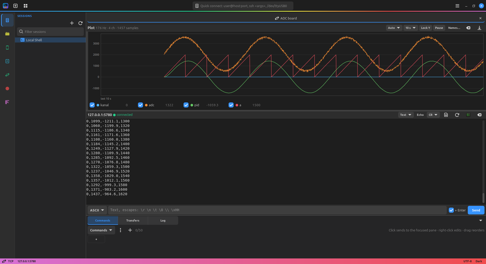

# Plot

A live graph of the numbers a pane prints, for ADC readings, control
loops, sensor values. Each line is one sample; its fields, split by a
separator, are the channels.

```
0,27200,1000,305,0,0      → 6 channels
0|2323|12312|232          → 4 channels
kanal,adc,pid,a           → channel names
bla bla bla               → skipped (still shown in the terminal)
```

Open it with the **Plot** button in the bottom right corner of the pane,
Ctrl+Shift+G or menu → Plot Values. The pane splits: graph above, terminal
below (drag the handle between them). The button is highlighted while the
plot is shown; it and the same keys close it.
It works in every pane: serial, TCP, telnet, SSH, shell.



## Lines

| Rule | Detail |
|---|---|
| Separator | Auto: the first of `,` `|` `;` Tab `:` in the line; or pick one. Space is never a separator; spaces around values are ignored |
| Numbers | `12`, `-3.5`, `1e3`, `0x1F` |
| Fields that are not numbers | Leave a gap in that channel |
| A line with no numbers | Skipped; if it has several fields, they become the channel names (`kanal,adc,pid`) |
| A line with one number | One channel |
| Trailing separator | `1,2,3,` is three values |
| Channels | Up to 32 |

Lines read together (e.g. 50 lines in one serial read) are spread evenly
over the time since the previous read, so a steady sample rate draws as
one.

## Controls

| Control | Effect |
|---|---|
| Separator | Auto or a fixed one |
| Span | Last 1, 5, 10, 30 or 60 seconds, or the last 200, 1000 or 5000 samples |
| Lock Y | Keeps the current Y range (otherwise it follows the shown values) |
| Pause | Freezes the view; samples are still kept. Unpausing goes back to the live view |
| Names… | Channel names, comma separated |
| ⌫ | Clears the samples |
| ⬇ | Saves all kept samples as CSV (`time_s,sample,<names>`) |

## Zoom and pan

| Mouse | Effect |
|---|---|
| Wheel | Zoom in or out around the pointer on both axes; the point under the pointer stays put. The view freezes and Lock Y turns on |
| Shift + wheel | Zoom the time (or sample) axis only |
| Ctrl + wheel | Zoom the Y axis only |
| Drag | Move the view: left/right in time (the view freezes), up/down in value (Lock Y turns on) |
| Double-click | Back to the live view with an automatic Y axis |

While frozen, new samples are still collected; nothing is lost. The line
under the plot tells how much is shown.

The legend has a checkbox per channel to hide or show it, and its value:
the latest one, or the one under the mouse pointer (a vertical line
marks the spot). The title shows the sample rate, channel count and
samples kept (at most 200000).

Drawing runs about 30 times a second whatever the sample rate; dense data
is reduced to the minimum and maximum per pixel column.
